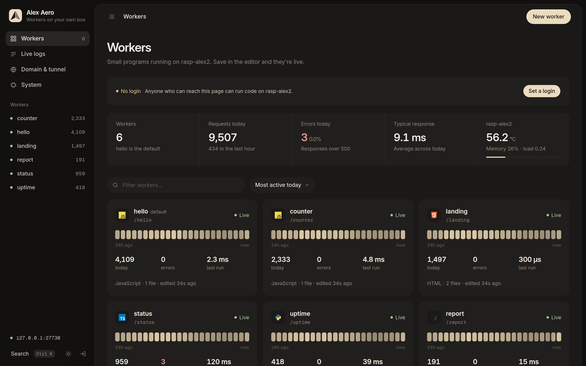

<p align="center">
  
</p>

<p align="center">
  
  
  
  
</p>

<p align="center">
  <b><a href="#-quick-start">Quick start</a></b> ·
  <b><a href="#-what-you-get">What you get</a></b> ·
  <b><a href="#-kv-and-schedules">KV & schedules</a></b> ·
  <b><a href="#-the-command-line">The CLI</a></b> ·
  <b><a href="#-performance">Performance</a></b> ·
  <b><a href="#-security">Security</a></b> ·
  <b><a href="#-reference">Reference</a></b>
</p>

---

**Alex·Aero** is Cloudflare Workers on your own machine. Write JavaScript, TypeScript, Python, Shell or plain HTML in the browser, press save, and it's live at `http://your-box/<name>`. JS and TS run in **workerd**, Cloudflare's own open-source runtime, with `env.KV`, cron `scheduled()` handlers, versions with one-click rollback, live logs and real per-hour metrics. Put it on your own domain through a Cloudflare Tunnel without opening a port.

```bash
git clone https://github.com/alexd-aero/alex-aero-workers.git && cd alex-aero-workers
./install.sh            # native: Linux or macOS
./install.sh --docker   # or Docker: anything that runs Docker, incl. Windows
```

## ⚡ Quick start

<table>
<tr>
<td width="50%" valign="top">

**1 · Install.** `./install.sh` finds Node 18+ (or downloads a private copy into `.node/`), installs workerd into `.workerd-local/`, links `ax` into `~/.local/bin`, asks for a login and starts it. On systemd machines it offers to start at boot and restart on crash.

**2 · Open it.** `http://<this-machine>:27715/` and sign in.

**3 · New worker.** Pick JavaScript, TypeScript, Python, Shell, an HTML page or JSON. It answers at `/<name>` straight away.

**Docker.** `./install.sh --docker` writes a `.env` with your login and runs `docker compose up -d`. One image for x86_64 and arm64; data lives in the `alex-aero-data` volume.

</td>
<td width="50%" valign="top">

```bash
ax                  # home screen (arrow keys)
ax up | down | restart
ax status [--json]
ax logs -f
ax passwd           # change the login
ax domain           # Cloudflare domain + tunnel
ax doctor --fix
ax autostart on     # boot + crash restart (systemd)

# without nginx: Node serves the port itself
AX_PROXY=direct ax up
```

</td>
</tr>
</table>

## 🧭 What you get

- **A real editor.** Monaco (VS Code's editor) with multiple files, a live preview, a request tester (method, headers, body) and a console that tails the worker's logs and requests as they happen. Works offline with a built-in fallback editor.
- **Versions.** Every file snapshotted; roll back the whole worker in one click.
- **Real metrics.** Requests, errors and response time per hour and per day, status codes, recent requests. Nothing estimated.
- **Routes.** Each worker answers at `/<name>`, plus any extra paths or a full URL on your domain. One worker can be the *default* and catch every unclaimed path.
- **Domain & tunnel.** Paste a Cloudflare Tunnel token; Alex·Aero runs the connector, keeps it up, and checks your DNS.
- **Sign-in.** A proper login page with session cookies, account settings, and a lockout that doesn't punish browsers retrying the same password.
- **Dark ("cream") and light ("latte") themes**, phone layout, command palette (<kbd>Ctrl</kbd>+<kbd>K</kbd>).

## 🗝️ KV and schedules

```js
export default {
  async fetch(request, env) {
    const visits = Number(await env.KV.get('visits')) + 1;
    await env.KV.put('visits', String(visits), { expirationTtl: 86400 });
    return Response.json({ visits });
  },
  async scheduled(event, env) {          // Settings → Schedules, e.g. "*/15 * * * *"
    console.log('tick', event.cron);
  }
};
```

`env.KV` supports `get` (text / json / arrayBuffer / stream), `put` with `expirationTtl`, `delete` and `list({ prefix, cursor })`, persisted in `storage/kv/<worker>.json` (4 MB per value, 128 MB per worker). The **Storage** tab browses and edits keys. Python and Shell workers get `AX_KV_URL` + `AX_KV_TOKEN`. Schedules take standard 5-field cron or `@hourly`/`@daily`/`@weekly`, run in the server's time zone (`TZ` in Docker), and have *Run now*.

## ⌨️ The command line

`ax` shows status and an arrow-key menu: start, stop, logs, domain, login, autostart, doctor. It only ever touches its own processes (found by pidfile and command line): it never stops system services, never kills whatever sits on a port, and never touches other cloudflared tunnels. If a port is taken by something else it says who has it and stops.

## 🚀 Performance

Raspberry Pi 5, 50 concurrent connections, autocannon on the same box:

| | Before 2.1 | 2.1 |
|---|---|---|
| JS worker | 470 req/s, median 103 ms | **1,524 req/s, median 29 ms** |
| Static page | 1,527 req/s | **3,626 req/s** |
| First request after saving | 35 ms (cold start) | **8 ms** (pre-warmed) |

Cached worker bundles (invalidated by `fs.watch`), keep-alive connections nginx → Node → workerd, streamed responses, single-flight starts, pre-warming after saves and at boot, and idle workers are stopped after 15 minutes to give memory back.

## 🔐 Security

Session cookies are HttpOnly and stored hashed; password changes sign out other devices. State-changing requests are checked with `Sec-Fetch-Site`/`Origin`, so other websites can't drive the dashboard through your browser. Forwarded client IPs are only trusted from a local proxy. Template values (`{{url}}`, `{{ip}}`…) are HTML-escaped in pages. The tunnel token never reaches the browser. Workers run your code with your user's permissions: in Docker they run as the unprivileged `node` user.

## 📖 Reference

<details>
<summary><b>Environment</b></summary>

| Variable | Default | |
|---|---|---|
| `PUBLIC_PORT` | `27715` | Dashboard + workers |
| `BACKEND_PORT` | `17156` | Node behind nginx (= `PUBLIC_PORT` in direct mode) |
| `AX_PROXY` | `auto` | `nginx`, `direct`, or nginx-if-installed |
| `BIND_HOST` | `127.0.0.1` | `0.0.0.0` in direct mode / Docker |
| `AX_ADMIN_USER` / `AX_ADMIN_PASSWORD` | | Create the login on first boot (Docker) |
| `TZ` | system | Time zone for schedules |

</details>

<details>
<summary><b>Files</b></summary>

```
server.js            the backend: routing, auth, workerd pool, KV, cron, API
public/              the dashboard (vanilla JS, no build step)
bin/ax, bin/ui.sh    the CLI
install.sh           native installer · Dockerfile, docker-compose.yml
storage/             workers/<name>/ (files + meta.json), kv/, auth.json, sessions.json, config.json
```

</details>

<details>
<summary><b>HTTP API</b> (signed in; changes must be same-origin)</summary>

`GET /api/overview` · `GET /api/workers/:name` · `GET /api/workers/:name/activity?since=` · `POST /api/workers` · `PUT|DELETE /api/workers/:name` · `POST|PUT|DELETE /api/workers/:name/files` · `POST /api/workers/:name/{routes,schedules,deployments,issues,observability}` · `GET|PUT|DELETE /api/workers/:name/kv` · `GET /api/system` · `PUT /api/config` · `POST /api/login|logout` · `GET|POST /api/account`. `GET /api/health` is public.

</details>

<sub>The screenshot shows a demo instance with synthesized traffic history.</sub>
